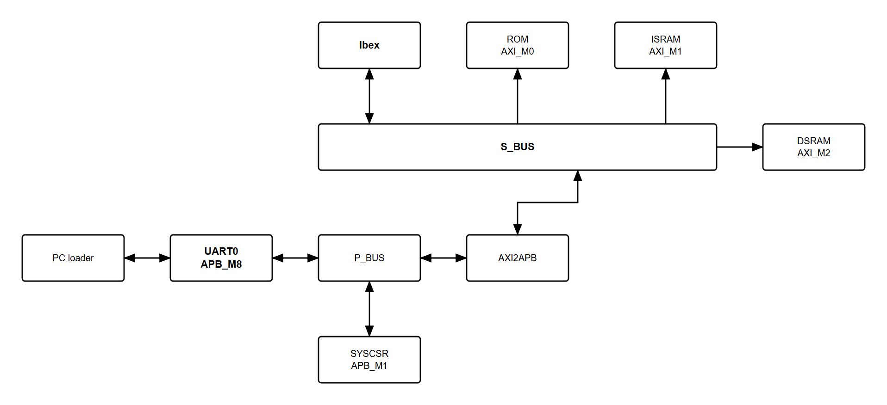
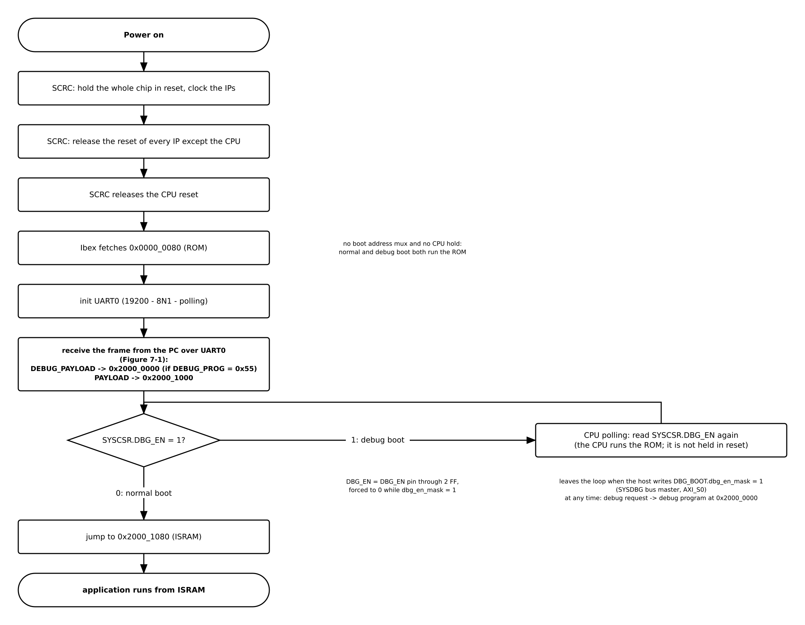
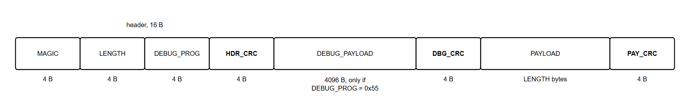
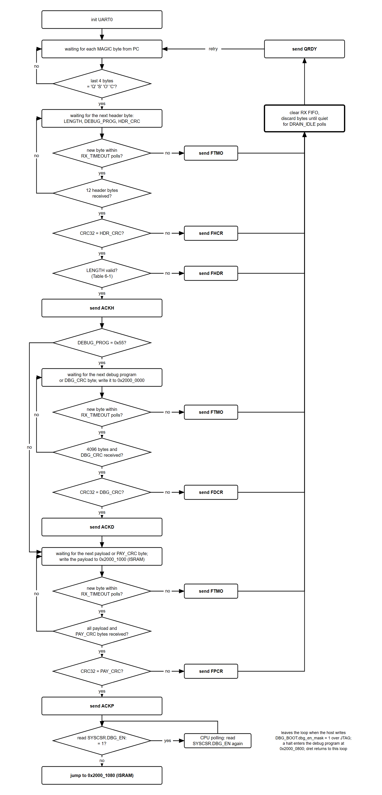
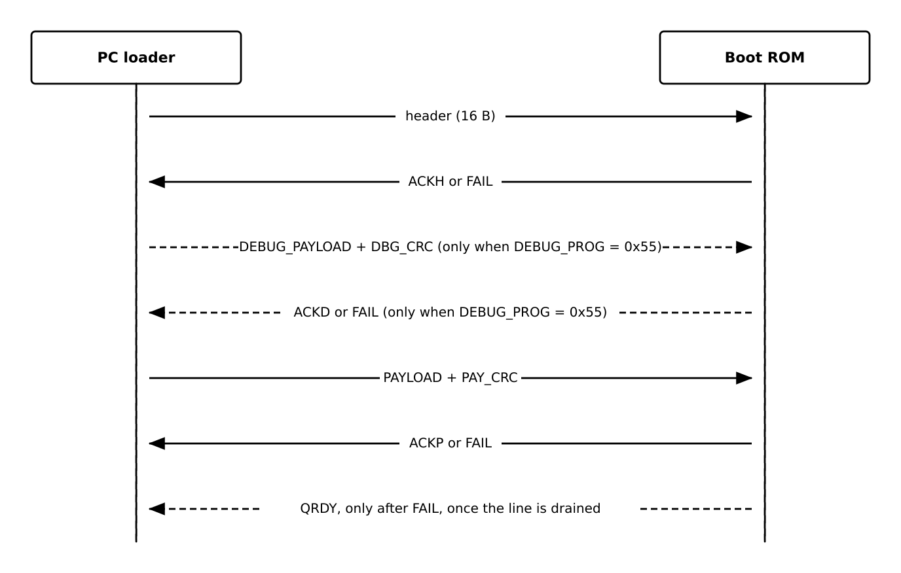

# Revision history

The reasoning behind each change, the V1.0--V2.2 history and the V2.2 text are in
[`QNSC_BOOT_DECISIONS.md`](QNSC_BOOT_DECISIONS.md).

| Version | Date | Author | Reviewer | Description of change |
|---|---|---|---|---|
| V3.0 | 2026-09-28 | Nghia VT (lead), for Nguyen Hao Nam | -- | V2.2 moved onto the template: `UART0` address corrected to `0x8002_0000`, hardware sequencing referenced to `SCRC`/`SYSDBG`, bootloader image limits moved here from the ROM, timing recomputed, monochrome figures |
| V3.1 | 2026-10-15 | Sinh | -- | New boot flow: the CPU always starts in ROM at `0x0000_0080`, with no boot-address mux; debug boot is the ROM code polling `SYSCSR.DBG_EN`, not a CPU held in reset; 19 200 baud; 16-byte header with `DEBUG_PROG`, optional debug payload with its own CRC, fixed load and entry addresses; new tokens `ACKD`, `FDCR`; timeouts of 1 000 000 and 500 000 polls |

# 1. Overview

QSOC has no Flash. After every reset the boot ROM downloads the application from a
PC into `ISRAM` over `UART0`, checks it, and jumps to it. This specification is the
bootloader, the frame and handshake between it and the PC loader, and what the
application can rely on.

The CPU always starts in the ROM, at `0x0000_0080`. A debug boot is not a different
reset vector: the ROM code loads the image like any other boot, then waits while the
`DBG_EN` status bit is set, so a debugger can take control before the user program
runs (section 4.1).

It is not a block and has no RTL. The hardware it runs on is `QNSC_ROM_MAS`,
`QNSC_SCRC_MAS` (reset and release order) and `QNSC_SYSCSR_MAS` (the `DBG_EN` bit).

Source `design/rom/boot/`, output `rom_image.hex`; owner Nguyen Hao Nam.

# 2. Features

- The same flow after every reset: power-on, watchdog, software -- 4.
- `UART0` at 19 200 baud 8N1, polled; data integrity is left to the CRCs -- 5.
- Frame: 16-byte header with its own CRC, an optional 4 KiB debug payload with its
  own CRC, the user payload with its CRC -- 6.
- A 4-byte token answers every step; any failure returns to `QRDY` -- 7.1.
- Nothing is written to RAM before the header is checked -- 7.1.
- Debug program at `0x2000_0000`, user program at `0x2000_1000`, up to 60 KiB; the
  CPU jumps to `0x2000_1080` -- 9.
- Debug boot: the ROM waits in a polling loop while `SYSCSR.DBG_EN` is 1 -- 4.1.

# 3. Boot path

{width=6.4in}

<!-- gen:memory_map ports=AXI_M0,AXI_M1,AXI_M2,APB_M8 -->
: Memory map, regions behind APB_M8 and AXI_M0 and AXI_M1 and AXI_M2

| Base | Size | Region | Port | Kind | Note |
|---|---|---|---|---|---|
| `0x00000000` | 2 KiB | `rom` | AXI_M0 | memory | Boot code, read-only, executable |
| `0x20000000` | 4 KiB | `isram_dbg` | AXI_M1 | memory | The debug window: the first 4 KiB of ISRAM, not a block of its own |
| `0x20001000` | 60 KiB | `isram` | AXI_M1 | memory | The downloaded application |
| `0x30000000` | 32 KiB | `dsram` | AXI_M2 | memory | Stack, heap and variables |
| `0x80020000` | 16 KiB | `uart_0` | APB_M8 | peripheral | Carries the boot download |
<!-- /gen -->

The bootloader runs from the ROM, keeps its stack in `DSRAM`, writes `ISRAM` from
`0x2000_0000` (debug program) and `0x2000_1000` (user program), and accesses no
peripheral other than `UART0` and `SYSCSR` (the `DBG_EN` bit, step 8).

# 4. Sequence

{width=6.4in}

: Boot steps

| Step | Done by | Specified in | Ends when |
|---|---|---|---|
| 1. Power on | board | -- | supply stable |
| 2. Hold and clock | `SCRC` | `QNSC_SCRC_MAS` 7.3 | the whole chip is in reset and clocked |
| 3. Release all but the CPU | `SCRC` | `QNSC_SCRC_MAS` 7.5 | every IP except the CPU released, then 16 clock cycles |
| 4. Release the CPU | `SCRC` | `QNSC_SCRC_MAS` 7.5 | CPU out of reset |
| 5. ROM start | Ibex, `crt0.S` | `QNSC_ROM_MAS` 6, section 8 | first instruction at `0x0000_0080`, `boot_main` called |
| 6. `UART0` set-up | bootloader | section 5 | `UART0` configured, polling |
| 7. Download | bootloader | sections 6 and 7 | `ACKP` sent |
| 8. Debug gate | bootloader | 4.1 | `SYSCSR.DBG_EN` = 0 |
| 9. Jump | bootloader | 7.5 | first instruction at `0x2000_1080` |

## 4.1 Debug gate (step 8)

After `ACKP` the ROM reads `SYSCSR.DBG_EN`. It is read-only. In RTL it is the
register `DBG_BOOT` at `0x8000_400C`: bit 0 `dbg_en`, bit 1 `dbg_en_mask`. The bit
follows the chip pin `DBG_EN` through two synchronising flip-flops and is forced to 0
while `DBG_EN_MASK` = 1:

```
DBG_EN = DBG_EN_MASK ? 0 : sync2(pin DBG_EN)
```

`DBG_EN_MASK` resets to 0.

- **`DBG_EN` = 1, debug boot.** The CPU stays in a ROM polling loop that re-reads
  `SYSCSR.DBG_EN`. It is not held in reset; it is running ROM code. Meanwhile JTAG
  may raise `cpu_dbg_en`, which puts the CPU in debug mode and sends it to the debug
  program at `0x2000_0800` (`DmHaltAddr`). On `dret` the CPU returns to the polling
  loop and reads `SYSCSR.DBG_EN` again: debug mode pauses the wait, it does not end
  it. Only `DBG_EN` = 0 lets the CPU leave.
- **Starting the user program.** JTAG writes `SYSCSR.DBG_EN_MASK` = 1 through the
  `SYSDBG` bus master (`AXI_S0`, `S_BUS`, `P_BUS`, `SYSCSR`). `DBG_EN` then reads 0
  and the CPU goes to step 9. JTAG can only clear the debug state; it cannot set
  `DBG_EN` to 1.
- **`DBG_EN` = 0, normal boot.** Go straight to step 9.
- **Pin high but `DEBUG_PROG` = `0xAA`** (no debug program). The ROM still polls, and
  sends no error token. `cpu_dbg_en` must not be raised, because there is no
  dispatch loop at `0x2000_0800`. JTAG can still write `DBG_EN_MASK` = 1 to let the
  user program run.

The debug program is a 4 KiB image that follows the debug window layout of section 9.

# 5. UART0 configuration

`UART0` is `pulp-platform/apb_uart` around `obi_uart`: 16550 registers at byte
offset 4 x *n*, 16-byte RX FIFO. The ROM configures it for 19 200 baud, 8 data bits,
1 stop bit, no parity (8N1), and reads it by polling `LSR`, with no interrupt. There
is no parity bit; the CRCs of section 6 check the data.

: `UART0` registers used, base `0x8002_0000`

| Offset | Register | Use |
|---|---|---|
| `0x00` | `RBR` / `THR` / `DLL` | receive, transmit; `DLL` = 65 while `DLAB` = 1 |
| `0x04` | `IER` / `DLM` | `IER` = 0; `DLM` = 0 while `DLAB` = 1 |
| `0x08` | `FCR` | `0x07`: FIFOs on, both cleared |
| `0x0C` | `LCR` | `0x80` (`DLAB`) while writing the divisor, then `0x03`: 8 bits, no parity, 1 stop |
| `0x14` | `LSR` | bit 0 data ready; bit 5 `THRE`; bit 6 `TEMT` |

Divisor 65 (derived here from the 20 MHz clock, not stated in the flow):
20 MHz / (16 x 65) = 19 231 baud, 0.16 % above 19 200. One byte takes 10 bits, about
520 µs.

# 6. Frame format

{width=6.4in}

```
MAGIC | LENGTH | DEBUG_PROG | HDR_CRC | [DEBUG_PAYLOAD (4096 B) | DBG_CRC] | PAYLOAD | PAY_CRC
```

`DEBUG_PAYLOAD` and `DBG_CRC` are present only when `DEBUG_PROG` = `0x0000_0055`.

: Header, 16 bytes

| Offset | Field | ROM check |
|---|---|---|
| `0x00` | `MAGIC` | a 4-byte constant defined in the ROM code (`boot.h`) |
| `0x04` | `LENGTH` | multiple of 4, at most 61 440 (60 KiB) |
| `0x08` | `DEBUG_PROG` | exactly `0x0000_0055` (debug program and user program) or `0x0000_00AA` (user program only) |
| `0x0C` | `HDR_CRC` | CRC32 of the first 12 bytes: `MAGIC`, `LENGTH`, `DEBUG_PROG` |

: After the header

| Field | Size | Written to | Check |
|---|---|---|---|
| `DEBUG_PAYLOAD` | 4096 B, only if `DEBUG_PROG` = `0x55` | `0x2000_0000` | `DBG_CRC` |
| `DBG_CRC` | 4 B | -- | CRC32 of `DEBUG_PAYLOAD` |
| `PAYLOAD` | `LENGTH` B | `0x2000_1000` | `PAY_CRC` |
| `PAY_CRC` | 4 B | -- | CRC32 of `PAYLOAD` |

`LENGTH` must be a multiple of 4 because `ISRAM` is written one word at a time, and
at most 60 KiB, the size of the application region, so a write never runs out of
`ISRAM`. A CRC cannot catch a wrong `LENGTH`, so the ROM range-checks it; likewise
`DEBUG_PROG`.

CRC32 is the zlib variant: reflected polynomial `0xEDB88320`, initial value and
final XOR `0xFFFF_FFFF`. The ROM computes it bitwise.

# 7. Bootloader behaviour

{width=5.0in}

## 7.1 Handshake

{width=5.6in}

The ROM receives in this order:

1. **`MAGIC`.** The PC sends 4 bytes. The ROM reads them one at a time, joins them
   into 4 bytes and compares with its constant. If they differ it slides by one byte
   and compares again as the next byte arrives. If the PC sends everything and
   nothing matches, the PC bootloader has a problem and detects it with its own
   timeout.
2. **Header.** The ROM polls the 12 remaining header bytes. Between two bytes it
   counts polls; 1 000 000 polls without a new byte give `FTMO`.
3. **`HDR_CRC`.** The ROM computes CRC32 over the first 12 bytes and compares. A
   mismatch gives `FHCR`.
4. **Range check.** `LENGTH` must be a multiple of 4 and at most 60 KiB;
   `DEBUG_PROG` must be `0x55` or `0xAA`. Otherwise `FHDR`.
5. **`ACKH`.** The header is valid. If `DEBUG_PROG` = `0x55` go to 6, if `0xAA` go to 9.
6. **Debug payload.** The ROM polls 4096 bytes of `DEBUG_PAYLOAD`, joins every 4
   bytes into a word and writes it to `0x2000_0000`, then reads `DBG_CRC`. 1 000 000
   polls without a byte give `FTMO`.
7. **`DBG_CRC`.** A mismatch gives `FDCR`.
8. **`ACKD`.** The debug payload is accepted; the PC sends the user payload.
9. **User payload.** The ROM polls `LENGTH` bytes, joins every 4 bytes into a word,
   writes it to `0x2000_1000`, then reads `PAY_CRC`.
10. **`PAY_CRC`.** A mismatch gives `FPCR`.
11. **`ACKP`.** The payload is accepted.

: Tokens, 4 ASCII bytes, sent by the ROM

| Token | Sent when |
|---|---|
| `QRDY` | the ROM is ready, or ready again after a failure; the PC may send the frame |
| `ACKH` | header received, `HDR_CRC` correct, `LENGTH` and `DEBUG_PROG` valid |
| `ACKD` | `DEBUG_PAYLOAD` received and `DBG_CRC` correct |
| `ACKP` | `PAY_CRC` correct |
| `FTMO` | no new byte in 1 000 000 polls |
| `FHCR` | `HDR_CRC` wrong |
| `FHDR` | `LENGTH` or `DEBUG_PROG` out of range |
| `FDCR` | `DBG_CRC` wrong |
| `FPCR` | `PAY_CRC` wrong |

- FAIL in Figure 7-2 is any failure token; Figure 7-1 shows which step sends which.
- Nothing is written to `ISRAM` before `ACKH`.

## 7.2 Failure and retry

Every failure token (`F***`) is followed by the same recovery:

1. The ROM sends the `F***` token, so the PC bootloader stops sending and waits.
2. It clears the RX FIFO of `UART0`.
3. It waits about 500 000 polls, discarding the bytes the PC had already sent for the
   aborted transfer, so the RX FIFO is certainly empty.
4. It sends `QRDY`; the PC resends the whole frame.

Words already in `ISRAM` are overwritten by the next frame. The watchdog is off after
reset (`aon_timer` `WDOG_CTRL` resets to 0), so a download that never completes waits
for the PC or a reset.

## 7.3 Timeouts

The bootloader uses no timer: a timeout is a count of `LSR` polls, each an APB
read estimated at 10 cycles or more.

: Timeouts

| Constant | Polls | At 10 cycles per poll | Meaning |
|---|---:|---|---|
| `RX_TIMEOUT` | 1 000 000 | 10 M cycles, 0.5 s at 20 MHz | no new byte, in the header and in both payloads |
| `DRAIN_POLLS` | 500 000 | 5 M cycles, 0.25 s at 20 MHz | discarding stale bytes after a failure |
| `MAGIC` hunt | -- | -- | waits for the PC; the PC has its own timeout |

A slower poll only lengthens a timeout, so the counts need no tuning. At 19 200 baud
a byte arrives every 520 µs, so 1 000 000 polls is far longer than the gap between two
good bytes.

## 7.4 Writing ISRAM

Each payload is written one 32-bit word per four received bytes: the debug payload
from `0x2000_0000`, the user payload from `0x2000_1000`.

## 7.5 Jump

After `ACKP` and the debug gate (4.1) the ROM waits for `LSR.TEMT` = 1, so the last
token has left `UART0`, executes `fence.i`, and jumps to `0x2000_1080`. It does not
return.

# 8. Bootloader image

: Limits, enforced by the build

| Limit | Value | Enforced by |
|---|---|---|
| Image | 2048 bytes, vector table included (`QNSC_ROM_MAS` 6) | `link.ld`, `util/gen_rom.py` |
| Code | 1 KiB after the vector table (Day005 review) | `make size` |
| Sections | `.text` only: no `.data`, `.bss` or `.rodata` | `link.ld` |

- `crt0.S` holds the 32 vectors and `_start` at `0x80`: `sp` = `0x3000_8000`, the
  top of `DSRAM`, then `boot_main`.
- Built with `-march=rv32imc_zicsr_zifencei`, which `fence.i` needs.
- The 1 KiB code budget is a watch item: this flow adds a bitwise CRC32 over the
  debug payload, nine tokens, the drain and the `DBG_EN` loop. `make size` decides.

: Source, `design/rom/boot/`

| File | Content |
|---|---|
| `boot.h` | Frame, tokens, timeouts; addresses from the generated `qnsc_map.h` |
| `crt0.S`, `boot.c` | Vectors and `_start`; the bootloader |
| `link.ld` | Layout and the limits above |
| `Makefile` | `make`, `make size`, `make test`; output `rom_image.hex` |
| `tools/qsoc_image.py` | Packs the debug and user binaries into a frame |
| `tools/qsoc_loader.py` | Sends a frame over a serial port and follows the handshake, with retries |
| `tools/rom_model.py`, `tools/test_protocol.py` | Python model of `boot.c`, and the loader run against it for every token (`make test`) |

# 9. Application contract

- The user program is linked at `0x2000_1000`. The first 4 KiB of `ISRAM` belong to the
  debug program; do not place anything else there.
- Put a 128-byte vector table at `0x2000_1000` and set `mtvec` to it; put `_start` at
  `0x2000_1080`, which is where the ROM jumps.
- Set up its own stack and data in `DSRAM`.
- Find `UART0` configured (19 200 baud 8N1, FIFOs on, interrupts off, transmitter
  empty), every peripheral clock running except `TIMER1`, and the watchdog off.
- Read and clear `SYSCSR` `RESET_CAUSE` (`QNSC_SYSCSR_MAS` 7.5).
- With `DEBUG_PROG` = `0x55`, JTAG may raise `cpu_dbg_en` at any time, including while
  the user program runs.

: Debug window layout, `0x2000_0000` to `0x2000_0FFF`

| Address | Content |
|---|---|
| `0x2000_0000`--`0x2000_07FF` | sequence area |
| `0x2000_0800` | dispatch loop, `DmHaltAddr` |
| `0x2000_0810` | exception handler, `DmExceptionAddr` |
| `0x2000_0F00` | result |
| `0x2000_0F08` | command word |
| `0x2000_0F0C` | resume flag |

The debug program must follow this layout; its entry is at offset `0x800` inside
`DEBUG_PAYLOAD`.

Download time at 19 231 baud and 10 bits per byte (derived): 60 KiB takes about
32 s, 22 KiB about 12 s, and a debug payload adds about 2 s.

# 10. Requirements on others, and open items

: Requirements on other owners

| Item | Owner | What it blocks |
|---|---|---|
| `qnsc_map.h` generated from the contract, as `qnsc_pkg.sv` is | lead | `boot.h` without typed addresses |
| `DBG_BOOT` register at `0x8000_400C` in `SYSCSR` (bit 0 `dbg_en`, bit 1 `dbg_en_mask`) | `SYSCSR` owner | step 8; `QNSC_SYSCSR_MAS` 7 marks `0x0C` and up as reserved today |
| `SYSDBG` bus master writes `DBG_EN_MASK` and raises `cpu_dbg_en` | `SYSDBG` owner | 4.1 |

Open items: `design/rom/boot/` is not yet in the repository. ROM owner.
The PC-side tools (`tools/qsoc_image.py`, `qsoc_loader.py`, `rom_model.py`) still follow
the V3.0 frame and must be updated to this flow.

# 11. Verification

1. `BOOT_001` After each reset source the first Ibex fetch is at `0x0000_0080` and
   happens after every other domain is out of reset.
2. `BOOT_002` The ROM sends `QRDY` after reset and accepts a correct frame: `ACKH`,
   `ACKD` when `DEBUG_PROG` = `0x55`, `ACKP`, then execution at `0x2000_1080`.
3. `BOOT_003` Bytes before `MAGIC` are skipped; a `MAGIC` that arrives shifted by a
   byte is found by sliding.
4. `BOOT_004` A wrong `HDR_CRC` gives `FHCR`; a `LENGTH` that is not a multiple of 4 or
   over 60 KiB, or a `DEBUG_PROG` other than `0x55` and `0xAA`, gives `FHDR`; none writes
   `ISRAM`.
5. `BOOT_005` A wrong `DBG_CRC` gives `FDCR`, a wrong `PAY_CRC` gives `FPCR`, and the
   ROM does not jump.
6. `BOOT_006` No new byte in 1 000 000 polls gives `FTMO`, in the header and in both
   payloads.
7. `BOOT_007` After every failure the ROM sends the token, drains the line, sends
   `QRDY` and accepts a resent frame.
8. `BOOT_008` After `ACKD` and `ACKP`, `ISRAM` equals the payloads word for word at
   `0x2000_0000` and `0x2000_1000`.
9. `BOOT_009` With `DBG_EN` = 1 the CPU stays in the polling loop, is not held in
   reset, and leaves it only after `DBG_EN_MASK` = 1; with `DBG_EN` = 0 it goes straight
   to `0x2000_1080`.
10. `BOOT_010` With `DBG_EN` = 1, raising `cpu_dbg_en` sends the CPU to `0x2000_0800`,
    and after `dret` it returns to the polling loop.
11. `BOOT_011` With `DBG_EN` = 1 and `DEBUG_PROG` = `0xAA`, the ROM polls and sends no
    error token.
12. `BOOT_012` The build fails when a limit of Table 8-1 is broken.
13. `BOOT_013` `make test` passes against `rom_model.py` for every token.

# Appendix A. Acronyms

: Acronyms

| Acronym | Description |
|---|---|
| CRC | Cyclic Redundancy Check |
| DLAB | Divisor Latch Access Bit, `LCR[7]` |
| LSR | Line Status Register |
| THRE, TEMT | Transmit holding register empty, transmitter empty |

# Appendix B. First review

: First review

| Item | Reviewer | Response |
|---|---|---|
| Handshake mandatory: ACK or failure per step | Quan (mentor), Day006 | 7.1 |
| Header checked separately from payload | Quan (mentor), Day006 | 6, `HDR_CRC` |
| First fetch is ROM base + `0x80` | Sinh | `QNSC_ROM_MAS` 6 |
| `UART0` at `0x8002_4000`, "APB slave 9" | lead, V3.0 | `0x8002_0000`, `APB_M8`, map generated in 3 |
| Word writes justified by "no byte-strobe path" | lead, V3.0 | `ISRAM` has byte strobes (`QNSC_RAM_MAS` 7.3); reason removed |
| Debug boot without holding the CPU; the CPU always runs the ROM | mentor, 2026-10-12 | 4.1 |
