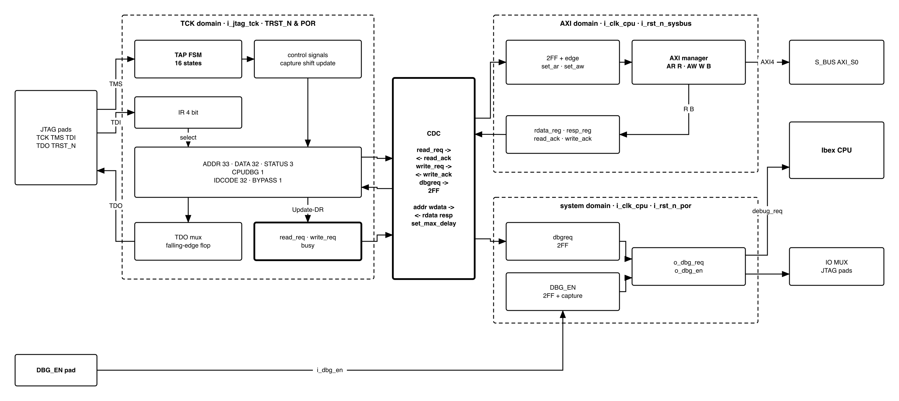
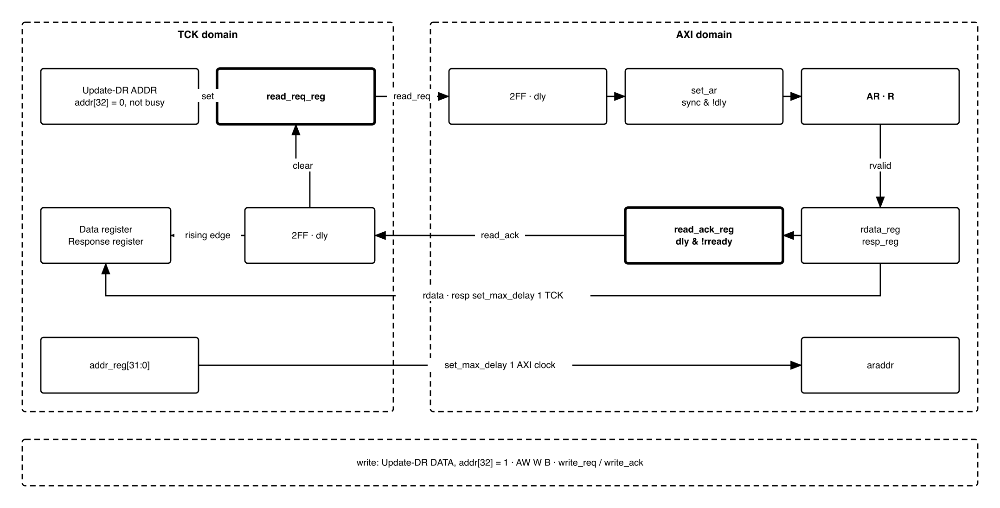

# Revision history

The reasoning behind each change, and every version before V3.0, is in
[`QNSC_SYSDBG_DECISIONS.md`](QNSC_SYSDBG_DECISIONS.md).

| Version | Date | Author | Reviewer | Description of change |
|---|---|---|---|---|
| V3.0 | 2026-09-23 | Nghia VT | -- | Rewritten after the teacher's reference design: JTAG data registers, native AXI4 manager, 4-phase handshake. Adds the `DBG_EN` pin and CPU hold |
| V3.1 | 2026-09-25 | Nghia VT | -- | Port names to `QNSC_RTL_Design_Naming_Rule` V1.0: `o_dbg_req`, `o_dbg_cpu_hold`, AXI named per channel (`o_bus_axi_ar_valid`, ...). No change in behaviour |
| V4.0 | 2026-10-15 | Nghia VT | -- | Follows the boot flow of `QNSC_BOOT_SPEC` V3.4 (mentor, 12/10 and 14/10). The CPU is never held, so `CPUHOLD`, `o_dbg_cpu_hold` and the boot address mux are gone. The boot ROM loads the debug program, so `SYSDBG` no longer writes the window at boot: 7.2 is the four cases of the boot flow. `o_dbg_en` stays, for the JTAG pads only. 7.7: a halt needs the debug program in the window; a request held across a watchdog or software reset halts the core before its first instruction; breakpoints. 7.8: the layout is the contract's `debug_window`, the mailbox moves to `0xF00` (`QNSC_BOOT_SPEC` Table 9-1). 9: `DbgTriggerEn` = 1, two hardware breakpoints (this document said 0, against its own `_DECISIONS` 5.2) |

# 1. Overview

`SYSDBG` is the QSOC debugger. A JTAG TAP takes commands from the host. An AXI4
manager on `AXI_S0` reads and writes memory. A 4-phase handshake links the two. It
also drives the Ibex `debug_req` input.

The CPU is never held. After every reset `SCRC` releases it and it runs the boot ROM,
which downloads the application over `UART0` and, when the frame carries one, a 4 KiB
debug program into the debug window (`QNSC_BOOT_SPEC`). One external pin, `DBG_EN`,
makes the ROM wait for the host after the download. The host ends the wait by
writing `DBG_BOOT.dbg_en_mask` of `SYSCSR` through this block's bus master, and can
halt the CPU into the debug program at any time, while the ROM waits or while the
application runs.

`SYSDBG` does **not** reset the chip, hold the CPU, gate a clock, or hold a debug
ROM. It has no memory-mapped registers: everything is reached through JTAG. It
captures `DBG_EN` once, to keep the JTAG pads on JTAG (7.1).

Block directory `design/sysdbg`, module `m_qnsc_sysdbg`, owner Nghia Van Trong.

# 2. Features

- JTAG TAP to IEEE 1149.1, 4-bit IR, six data registers.
- AXI4 manager: one-beat, 32-bit word reads and writes to any address, **including
  while the CPU runs**. One transaction at a time.
- 4-phase request/acknowledge handshake between the TCK and AXI clock domains.
- Halt through `debug_req`, set and cleared by the host.
- Debug while the boot ROM waits and while the application runs: the CPU is never
  held, and a halt enters the debug program that the ROM loaded into the window.
- Two hardware breakpoints (`DbgTriggerEn` = 1), also in the read-only ROM.

# 3. Block diagram

{width=6.5in}

Three domains, as labelled in the figure: TCK (`i_jtag_tck`, reset `i_jtag_trst_n`
AND `i_rst_n_por`), AXI (`i_clk_cpu`, reset `i_rst_n_sysbus`) and system (`i_clk_cpu`,
reset `i_rst_n_por`). `i_clk_cpu` is the `cpu` cluster clock, the same clock as
`S_BUS`, and is never gated.

# 4. IP used

: Upstream IP used

| From | Module | Commit | Licence |
|---|---|---|---|
| -- | -- | -- | -- |

In house. Nothing is instantiated.

# 5. Interface

: SYSDBG interface

| Signal | Dir | Width | Description |
|---|---|---:|---|
| `i_clk_cpu` | in | 1 | System and AXI clock, 20 MHz |
| `i_rst_n_por` | in | 1 | Power-on reset only |
| `i_rst_n_sysbus` | in | 1 | `S_BUS` domain reset. Resets the AXI domain |
| `i_jtag_tck` | in | 1 | JTAG clock. Asynchronous to `i_clk_cpu`, may stop at any time |
| `i_jtag_tms`, `i_jtag_tdi` | in | 1 | Sampled on rising `TCK` |
| `i_jtag_trst_n` | in | 1 | JTAG reset |
| `o_jtag_tdo` | out | 1 | Changes on falling `TCK` |
| `o_jtag_tdo_oe` | out | 1 | 1 in Shift-IR and Shift-DR only |
| `i_dbg_en` | in | 1 | From the `DBG_EN` pad. Asynchronous, captured once -- 7.1 |
| `o_dbg_en` | out | 1 | Captured `DBG_EN`. Forces the JTAG pins to JTAG, in the IO MUX. Not a boot address and not a CPU hold |
| `o_dbg_req` | out | 1 | To Ibex `debug_req_i`. Level, from a flip-flop |
| `o_bus_axi_ar_valid`, `i_bus_axi_ar_ready` | out, in | 1 | AR handshake |
| `o_bus_axi_ar_addr` | out | 32 | Read address, `[1:0]` = 0 |
| `i_bus_axi_r_valid`, `o_bus_axi_r_ready` | in, out | 1 | R handshake |
| `i_bus_axi_r_data` | in | 32 | Read data |
| `i_bus_axi_r_resp` | in | 2 | Read response |
| `o_bus_axi_aw_valid`, `i_bus_axi_aw_ready` | out, in | 1 | AW handshake |
| `o_bus_axi_aw_addr` | out | 32 | Write address, `[1:0]` = 0 |
| `o_bus_axi_w_valid`, `i_bus_axi_w_ready` | out, in | 1 | W handshake |
| `o_bus_axi_w_data` | out | 32 | Write data |
| `i_bus_axi_b_valid`, `o_bus_axi_b_ready` | in, out | 1 | B handshake |
| `i_bus_axi_b_resp` | in | 2 | Write response |
| Other AXI4 signals | -- | -- | Constant outputs or unused inputs -- section 10 |

: SYSDBG parameters

| Parameter | Default | Meaning |
|---|---|---|
| `IdcodeValue` | `0x0515_3001` | Part `0x5153` ("QS"), manufacturer `0x000`, bit 0 = 1 |
| `AxiIdWidth` | 5 | `S_BUS` slave-port ID width |
| `SyncStages` | 2 | Flip-flops per synchroniser |

# 6. Register map

No memory-mapped registers. The registers below are JTAG data registers,
selected by the IR and shifted LSB first.

: JTAG instructions and data registers

| IR | Name | Bits | Capture-DR loads | Update-DR does | Reset |
|---|---|---:|---|---|---|
| `0100` | `ADDR` | 33 | `addr_reg` | Load `addr_reg`. If bit 32 = 0 and not busy: start a read | 0 |
| `0101` | `DATA` | 32 | `rdata_hold`, the last read data | Load `wdata_reg`. If `addr_reg[32]` = 1 and not busy: start a write | 0 |
| `0110` | `STATUS` | 3 | {`busy`, `resp[1:0]`} | Nothing | 0 |
| `0111` | `CPUDBG` | 1 | `dbgreq` | Load `dbgreq` | 0 |
| `1110` | `IDCODE` | 32 | `IdcodeValue` | Nothing | -- |
| `1111` | `BYPASS` | 1 | 0 | Nothing | -- |
| others | as `BYPASS` | 1 | 0 | Nothing | -- |

- `addr_reg[32]` is the direction: 0 read, 1 write. `addr_reg[1:0]` are ignored.
- `resp` is the AXI response of the last completed transaction: `00` OKAY, `10`
  SLVERR, `11` DECERR.
- IR is 4 bits. Capture-IR loads `0001`. Test-Logic-Reset loads `IDCODE`.
- `1000` was `CPUHOLD` until V3.1. It now acts as `BYPASS`, like every unused code.

# 7. Functional behaviour

## 7.1 DBG_EN and the JTAG pads

The system domain synchronises `i_dbg_en` and captures it **once**, `SyncStages` + 1
cycles after `i_rst_n_por` releases. The captured value is `o_dbg_en`. It holds until
the next power-on reset, so a later change of the pad does nothing.

`o_dbg_en` has one use: while it is 1 the IO MUX keeps the five JTAG pads on JTAG, so
firmware that remaps pins cannot cut the debugger off in a debug session
(`_DECISIONS` 4.3.1). It does not decide how the CPU starts. **The CPU is never held
and has one boot address, the ROM** (`QNSC_BOOT_SPEC` 4).

What `DBG_EN` means to the boot ROM is not decided here. `SYSCSR` passes the pin
through two flip-flops into `DBG_BOOT.dbg_en`, which the ROM polls (`QNSC_SYSCSR_MAS`
7.5). This block only ends the wait, by writing `DBG_BOOT.dbg_en_mask` = 1 (7.2). The
pad therefore goes to two places: `SYSCSR` `i_dbg_en` and this block's `i_dbg_en`.

## 7.2 Debug while the ROM waits, and while the application runs

: The `DBG_EN` pin and the frame header's `DEBUG_PROG` (`QNSC_BOOT_SPEC` Figure 4-2)

| `DBG_EN` pin | `DEBUG_PROG` | After the download | For `SYSDBG` |
|---|---|---|---|
| 0 | not `0x55` | The ROM jumps to `0x2000_1080` | No debug program. The host must not raise `CPUDBG` |
| 1 | `0x55` | The ROM polls `DBG_BOOT.dbg_en` until the host writes `dbg_en_mask` = 1 | **Debug boot.** The host halts the CPU into the debug program at any time during the wait |
| 0 | `0x55` | The ROM jumps to `0x2000_1080` | **Attach later.** The host raises `CPUDBG` while the application runs |
| 1 | not `0x55` | The ROM polls as above and sends no token | Operator mistake. No debug program, so the host must not raise `CPUDBG`; it only writes `dbg_en_mask` = 1 so that the application runs |

**Debug boot.** The host takes these steps, in order:

1. Power on with `DBG_EN` = 1. `SCRC` releases the chip and the CPU runs the ROM. The
   JTAG pads are on JTAG (7.1); the host may use `SYSDBG` from this moment.
2. The PC sends the frame with `DEBUG_PROG` = `0x55`. The ROM writes the debug program
   to `0x2000_0000` and answers `ACKD`, then writes the application and answers
   `ACKP`. **The host must not raise `CPUDBG` before `ACKD`**: until then the window
   holds nothing to enter (7.7).
3. The ROM polls `DBG_BOOT`. The host sets `CPUDBG` = 1. Ibex saves the PC of the
   interrupted polling instruction in `dpc` and enters the dispatch loop at `DmHaltAddr`.
4. The host reads and writes memory and CPU registers with sequences (7.4, 7.8) and
   sets breakpoints (7.7).
5. The host writes `CPUDBG` = 0 first, then `RESUME` = 1. `dret` returns to the polling
   loop. A debug request suspends the wait, it does not end it.
6. To stop on the application's first instruction, the host halts the CPU, plants a
   breakpoint at `0x2000_1080` (7.7), writes `DBG_BOOT.dbg_en_mask` = 1 and resumes.
   The write is a word write of `0x0000_0002` to `0x8000_400C` through the bus master;
   it needs no help from the CPU, so it also works while the CPU is halted.

**Attach later** is steps 3 to 5 with the application running instead of the polling
loop.

The ROM itself cannot be debugged from its first instruction after a power-on: until
`ACKD` the window is empty. After a watchdog or software reset it still holds the
program, and 7.7 gives the way in.

## 7.3 Reset behaviour

: What each reset does

| Event | TCK domain | AXI domain | System domain | CPU |
|---|---|---|---|---|
| Power-on | Reset | Reset | Reset: `dbgreq` = 0, `DBG_EN` captured again | `SCRC` releases it, it runs the ROM |
| Watchdog bite, software reset | -- | Reset. A request still held is issued again on release | -- (`dbgreq` and `o_dbg_en` keep their values) | `SCRC` releases it. With `dbgreq` = 1 it halts before its first instruction (7.7) |
| `i_jtag_trst_n` | Reset: `dbgreq` = 0 | -- | -- | -- |

## 7.4 Reading and writing memory

**Read** of address `A`:

1. IR = `ADDR`, DR = {0, `A`}. Update-DR starts the read.
2. IR = `STATUS`, scan until `busy` = 0. Check `resp`.
3. IR = `DATA`, scan. The captured value is the read data.

**Write** of `D` to address `A`:

1. IR = `ADDR`, DR = {1, `A`}. Nothing is issued.
2. IR = `DATA`, DR = `D`. Update-DR starts the write.
3. IR = `STATUS`, scan until `busy` = 0. Check `resp`.

**Rules:**

- While `busy` = 1, Update-DR of `ADDR` and `DATA` is **ignored**: no register
  changes and no transaction starts.
- While `addr_reg[32]` = 1, every Update-DR of `DATA` starts another write, to the
  same address.

`busy` = `read_req` OR synchronised `read_ack` OR `write_req` OR synchronised
`write_ack`, all on the TCK side.

## 7.5 AXI manager

{width=6.5in}

`set_ar` is the rising edge of the synchronised `read_req`. `set_aw` is the same for
`write_req`.

: AXI manager behaviour

| Event | Read | Write |
|---|---|---|
| `set_ar` / `set_aw` | `arvalid` = 1, `araddr` = `addr_reg`, `rready` = 1 | `awvalid` = 1, `awaddr` = `addr_reg`, `wvalid` = 1, `wdata` = `wdata_reg`, `bready` = 1 |
| Address handshake | `arvalid` = 0 | `awvalid` = 0 |
| Data handshake | `rdata_reg` = `rdata`, `resp_reg` = `rresp`, `rready` = 0 | `wvalid` = 0 |
| Response handshake | -- | `resp_reg` = `bresp`, `bready` = 0 |
| Acknowledge | `read_ack` = synchronised `read_req` after the delay flip-flop, AND NOT `rready` | `write_ack` = synchronised `write_req` after the delay flip-flop, AND NOT `bready` |

At most one transaction is outstanding.

## 7.6 Clock domain crossing

Each transaction is one 4-phase handshake:

1. TCK side sets `req`.
2. AXI side sees `req` rise and runs the transaction.
3. AXI side raises `ack` and holds it while `req` = 1.
4. TCK side sees `ack` rise, captures `resp_reg` into `resp` (and, for a read,
   `rdata_reg` into `rdata_hold`), then clears `req`.
5. AXI side sees `req` fall and drops `ack`.
6. TCK side sees `ack` fall and is no longer busy.

: Crossing signals and constraints

| Signal | Direction | How it crosses | Constraint |
|---|---|---|---|
| `read_req`, `write_req` | TCK to AXI | `SyncStages` flip-flops, then one delay flip-flop for the edge | `set_max_delay -datapath_only`, one `i_clk_cpu` period, to the first flip-flop |
| `read_ack`, `write_ack` | AXI to TCK | `SyncStages` flip-flops, then one delay flip-flop for the edge | the same, one `TCK` period |
| `addr_reg`, `wdata_reg` | TCK to AXI | No synchroniser. Stable from `req` rising until `ack` falls | `set_max_delay -datapath_only`, one `i_clk_cpu` period |
| `rdata_reg`, `resp_reg` | AXI to TCK | No synchroniser. Stable from `ack` rising until the next `req` | `set_max_delay -datapath_only`, one `TCK` period |
| `dbgreq` | TCK to system | `SyncStages` flip-flops | `set_max_delay -datapath_only`, one `i_clk_cpu` period, to the first flip-flop |

## 7.7 Halt and resume

- **Halt.** `CPUDBG` = 1 drives `o_dbg_req` high. Ibex saves the PC in `dpc` and jumps
  to `DmHaltAddr` = `0x2000_0800`. The window code sets `HALTED` = 1; the host reads it
  to confirm the halt.
- **A debug program must be there.** Raise `CPUDBG` only after the ROM has sent
  `ACKD`, that is, after a frame with `DEBUG_PROG` = `0x55`. Without it `0x2000_0800`
  holds whatever the RAM holds, and the halt runs it. `SYSDBG` does not check this.
- **Halt after a reset.** `CPUDBG` = 1 across a watchdog or software reset halts the
  core before its first instruction, at `dpc` = `0x0000_0080`: `debug_req` is still
  high when `SCRC` releases the CPU, and the debug program is still in `ISRAM`, which
  no reset clears. After a power-on reset it does not work: `CPUDBG` is cleared and
  `ISRAM` holds nothing. A `TRST` clears `CPUDBG` as well.
- **Resume.** The host writes `CPUDBG` = 0 **first**, then `RESUME` = 1 in the debug
  window. The loop executes `dret`. If `debug_req` were still high, the core would
  halt again at the next instruction. The core goes back to where it was: the ROM's
  polling loop, or the application.
- **Breakpoints.** `DbgTriggerEn` = 1 and `DbgHwBreakNum` = 2 give two hardware
  breakpoints, set by sequences that write `tselect`, `tdata1` and `tdata2`. They work
  in the ROM, which cannot be patched. A software breakpoint is an `ebreak` written over
  the instruction in `ISRAM` and restored afterwards; it enters Debug Mode only if
  `dcsr.ebreakm` = 1, which a sequence sets once.

## 7.8 Debug window

The first 4 KiB of `ISRAM`, `0x2000_0000`--`0x2000_0FFF`. The layout is the contract's
`debug_window` (`util/qsoc_contract.yml`) and the table below is generated from it. The
same numbers are Ibex's `DmBaseAddr`, `DmAddrMask`, `DmHaltAddr` and `DmExceptionAddr`,
and `QNSC_BOOT_SPEC` Table 9-1.

Who writes what:

- The **boot ROM** writes the debug program, 4096 bytes from `0x2000_0000`, when
  `DEBUG_PROG` = `0x55` (`QNSC_BOOT_SPEC` 6 and 7). The dispatch loop, the exception
  handler and the mailbox are part of that program.
- **`SYSDBG` writes the sequence area** at run time, one sequence at a time, and reads
  and writes the mailbox (7.4).
- Firmware places nothing here. The application is linked at `0x2000_1000`.

<!-- gen:debug_window -->
: Debug window, the first 4 KiB of `ISRAM`

| Offset | Address | Size | Name | Contents |
|---|---|---|---|---|
| `0x000`--`0x7FF` | `0x20000000` | 2048 B | sequence area | Instruction sequences, written by the host through `SYSDBG` |
| `0x800`--`0x80F` | `0x20000800` | 16 B | `DmHaltAddr` | Dispatch loop entry: Ibex enters here on every halt |
| `0x810`--`0x81F` | `0x20000810` | 16 B | `DmExceptionAddr` | Exception handler: a fault in Debug Mode |
| `0x820`--`0xEFF` | `0x20000820` | 1760 B | code | Rest of the dispatch loop |
| `0xF00` | `0x20000F00` | 4 B | `data` | Result word, the value a sequence was sent to fetch |
| `0xF04` | `0x20000F04` | 4 B | `exc` | Exception flag, 1 after a fault in Debug Mode |
| `0xF08` | `0x20000F08` | 4 B | `cmd` | Command word, non-zero when a sequence is ready at the base; the sequence clears it |
| `0xF0C` | `0x20000F0C` | 4 B | `resume` | Resume flag, non-zero tells the dispatch loop to execute dret; the loop clears it first |
| `0xF10` | `0x20000F10` | 4 B | `halted` | Halted flag, 1 while the core is in Debug Mode |
| `0xF14`--`0xFFF` | `0x20000F14` | 236 B | reserved | Scratch, unused |
<!-- /gen -->

The code of the dispatch loop and of the sequences is host software and part of the
debug program, in `_DECISIONS`, "Debug window code". The ROM does not look at the
content of the program, only at its CRC.

# 8. Instances

One, in `design/top`, with the default parameters.

# 9. What is not provided here, and who provides it

: Functions this block does not provide

| Function | Where it lives |
|---|---|
| Reset of the chip or of any domain, holding the CPU | Nowhere. The CPU is never held (V4.0): the boot ROM runs after every reset |
| CPU clock control | Not needed. The `cpu` cluster is never gated |
| Byte and halfword access, bursts | Nowhere. Word only; the host does read-modify-write |
| Debug ROM, program buffer | Nowhere. The debug program in `ISRAM`, loaded by the boot ROM, 7.8 |
| `dret`, stepping, `ebreak`, triggers | Ibex, driven by code in the debug window. Two hardware triggers (`DbgTriggerEn` = 1, `DbgHwBreakNum` = 2) |

# 10. Tie-offs

: Tie-offs

| Port | Tied to | Why |
|---|---|---|
| `o_bus_axi_ar_len`, `o_bus_axi_aw_len` | 0 | One beat |
| `o_bus_axi_ar_size`, `o_bus_axi_aw_size` | `3'b010` | 4 bytes, word only |
| `o_bus_axi_ar_burst`, `o_bus_axi_aw_burst` | `2'b01`, INCR | Legal for one beat |
| `o_bus_axi_ar_id`, `o_bus_axi_aw_id` | 0 | One transaction outstanding |
| `o_bus_axi_{ar,aw}_lock`, `_prot`, `_cache`, `_qos`, `_region` | 0 | No exclusive access, protection, cache hints or QoS |
| `o_bus_axi_w_strb` | `4'b1111` | Word only |
| `o_bus_axi_w_last` | 1 | One beat |
| `i_bus_axi_r_id`, `i_bus_axi_r_last`, `i_bus_axi_b_id` | Unused | One beat, one ID |

# 11. Requirements on others, and open items

: Requirements on other owners

| Item | Owner | What it blocks |
|---|---|---|
| `DBG_EN` on a dedicated input pad, pull-down on the board, wired to `SYSCSR` `i_dbg_en` **and** to this block's `i_dbg_en`. It may share a pad with a function the IO MUX selects after reset (`UART0_CTSN`): `SYSCSR` reads the pin all the time, this block only once | Top, pad owner | Debug boot |
| `i_rst_n_por` from power-on only, not from the watchdog | `SCRC` | `DBG_EN` capture, and `dbgreq` surviving a watchdog bite (7.7) |
| `DmBaseAddr`, `DmAddrMask`, `DmHaltAddr`, `DmExceptionAddr` taken from the contract's `debug_window`, tagged `// contract: debug_window.<key>`. `DbgTriggerEn` = 1, `DbgHwBreakNum` = 2. `DmBaseAddr`/`DmAddrMask` act only with PMP, which is off | CPU owner | 7.7, 7.8 |
| `boot_addr_i` is the ROM base, no mux. `fetch_enable_i` tied to `IbexMuBiOn`: the CPU is not held | CPU owner | The CPU running the ROM after every reset |
| `AXI_S0` connected to `SYSDBG` directly, AXI4, ID width `AxiIdWidth`. No `axi_from_mem` | Bus owner | Every bus access |
| `AXI_S0` reaches `SYSCSR` (`APB_M1`) through `S_BUS`, `AXI2APB` and `P_BUS`: a word write to `0x8000_400C` | Bus owner | Ending the ROM's wait (7.2 step 6) |
| Remove the `0xF000_0000` `SYSDBG` register region from HAS Table 7-1 (already gone from `qsoc_contract.yml`) | HAS owner | Consistency. There are no memory-mapped registers |
| The five JTAG pads forced to JTAG while `o_dbg_en` = 1 | IO MUX owner | A debug session with firmware that remaps pins |
| `ISRAM` array has no reset and no clear-on-reset | RAM owner | The debug program surviving a watchdog or software reset (7.7) |
| `QNSC_BOOT_SPEC` Table 9-1 adds `HALTED` at `0x2000_0F10` and cites the contract's `debug_window` instead of `_DECISIONS` 4.11 | Boot owner | The layout of 7.8 in one place |
| The 4096-byte debug program: dispatch loop, exception handler, mailbox. It goes into the frame with `qsoc_image.py --debug` | Lead (this block) | Every halt |
| Image linked at `0x2000_1000`, reset entry `0x2000_1080`; bootloader jumps to `0x2000_1080` | Firmware owner | The same image in every case of 7.2 |

**Accepted limits:**

1. No timeout: a slave that never answers keeps `busy` = 1 until an `S_BUS` reset
   or power-on.
2. While `DBG_EN` = 0, firmware can take the JTAG pins.
3. No halt before the first ROM instruction after a power-on: the window is empty
   until the ROM loads the program (7.2, 7.7).
4. `SYSDBG` does not check that a debug program is in the window before a halt (7.7).

# 12. Verification

1. TAP: all 16 states from every state; `IDCODE` after reset; `BYPASS` and unused
   IR codes are 1 bit; IR changes only at Update-IR; Capture-IR loads `0001`.
2. Each data register of section 6: length, capture value, update effect, reset value.
3. Read and write sequences of 7.4 against an AXI slave model with random
   `ready`/`valid` delays. Every transaction issued exactly once, with the fixed
   fields of section 10.
4. Update-DR of `ADDR` or `DATA` while busy changes nothing.
5. `SLVERR` and `DECERR` reach `STATUS.resp`.
6. AXI protocol checker on the manager port for every test.
7. CDC: `TCK` from 10x slower to 10x faster than `i_clk_cpu`, and `TCK` stopped
   mid-handshake for 10,000 cycles. CDC lint: only the signals of the crossing
   table cross.
8. `i_rst_n_sysbus` asserted during a transaction: the transaction is issued
   again after release, and completes.
9. `DBG_EN`: `o_dbg_en` = 0 until the capture, then the pin value at the capture.
   Toggling the pad afterwards changes nothing. `o_dbg_en` never glitches (it is a
   flip-flop output).
10. With Ibex and the boot ROM, debug boot: frame with `DEBUG_PROG` = `0x55`. After
    `ACKD`, `CPUDBG` = 1: `HALTED` = 1 and `dpc` is inside the ROM's polling loop.
    `CPUDBG` = 0, `RESUME` = 1: `HALTED` = 0, the core is back in the loop and halts
    no more.
11. With Ibex, attach later: `DBG_EN` = 0, the application runs; halt, read `dpc`,
    resume.
12. The ROM's wait: with the CPU halted, write `DBG_BOOT` = `0x0000_0002` through
    `SYSDBG`; resume; the ROM jumps to `0x2000_1080`.
13. Halt after a reset: `CPUDBG` = 1, watchdog reset; the core halts at `dpc` =
    `0x0000_0080` with the program intact. After a power-on reset it does not, and
    `CPUDBG` reads 0.
14. Breakpoints: a hardware trigger in the ROM and at `0x2000_1080`; an `ebreak` in
    `ISRAM` with `dcsr.ebreakm` = 1.
15. `DEBUG_PROG` not `0x55` and `DBG_EN` = 1: the ROM waits, the host writes
    `dbg_en_mask` = 1, the application runs.

**Acceptance:** send a frame with a debug program and an application that toggles a
GPIO, with `DBG_EN` = 1. Halt the CPU in the ROM's wait loop and read `dpc`. Plant a
breakpoint at `0x2000_1080`, write `dbg_en_mask` = 1 through `SYSDBG` and resume. The
core stops at the breakpoint; resume it and see the GPIO toggle.

# Appendix A. Acronyms

: Acronyms

| Acronym | Description |
|---|---|
| CDC | Clock Domain Crossing |
| DR, IR | JTAG Data and Instruction Register |
| `dpc` | Debug PC: where `dret` returns |
| `dret` | Instruction that leaves Debug Mode |
| POR | Power-On Reset |
| SCRC | System Clock Reset Control |
| TAP | Test Access Port, IEEE 1149.1 |

# Appendix B. First review

: First review

| Item | Reviewer | Response |
|---|---|---|
| The block diagram does not show where the FSM and the CDC are | Teacher, 2026-09-23 | Section 3 separates the three domains. 7.6 gives the handshake, its signals and its constraints |
| Too long, and the repetition causes errors | Teacher, 2026-09-23 | Rewritten as V3.0. The reasoning moved to `_DECISIONS` |
| Who loads the 4 KiB debug program, and when? | Teacher, 2026-09-23 | V3.0: the host, over JTAG. **V4.0: the boot ROM, over `UART0`**, when the frame has `DEBUG_PROG` = `0x55` -- 7.2, 7.8 |
| The debugger must control the CPU reset, selected by an external pin | Teacher, 2026-09-23 | V3.0: `DBG_EN` and `CPUHOLD`. **Dropped in V4.0**: the mentor's boot flow of 12/10 never holds the CPU -- 7.1, `_DECISIONS` V4.0 |
| Reference design `VLSI_SYSDBG.drawio` | Teacher, 2026-09-23 | Used as the pattern and adapted to QSOC -- `_DECISIONS` D18 |
| CPU clock under debugger control | Teacher, 2026-09-23 | Not needed: the `cpu` cluster is never gated |
| IP list names `axi_from_mem` for the debugger | Owner, 2026-09-25 | An early pick from the V1.x memory-style port. The block is self-designed, as the teacher asks: its own AXI4 manager (7.5) connects to `AXI_S0` directly, and no IP is instantiated -- `_DECISIONS` D21 |
| The CPU is never held and the boot ROM loads the debug program | Quan (mentor), 12/10 and 14/10, in `QNSC_BOOT_SPEC` V3.4 | V4.0: 1, 7.1, 7.2, 7.8 |
| This document and `QNSC_BOOT_SPEC` Table 9-1 gave different mailbox addresses (`0x700`, `0xF00`) | Lead, 14/10 | 7.8 and the contract: the numbers of Table 9-1 |
